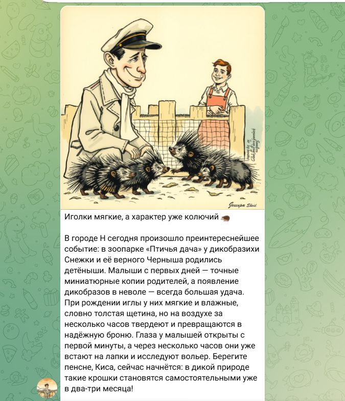
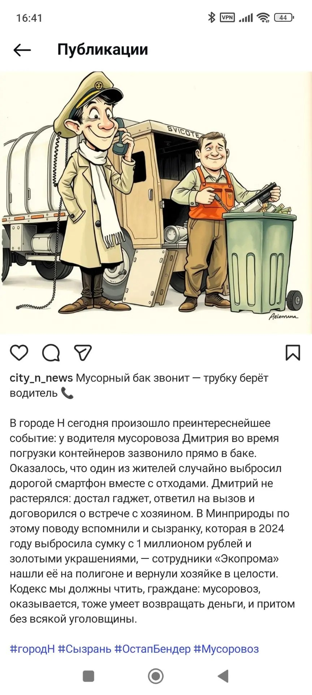
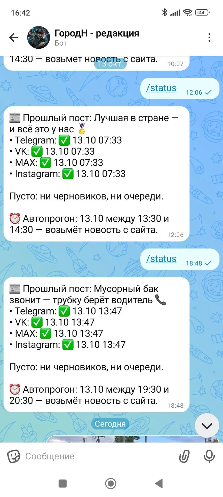
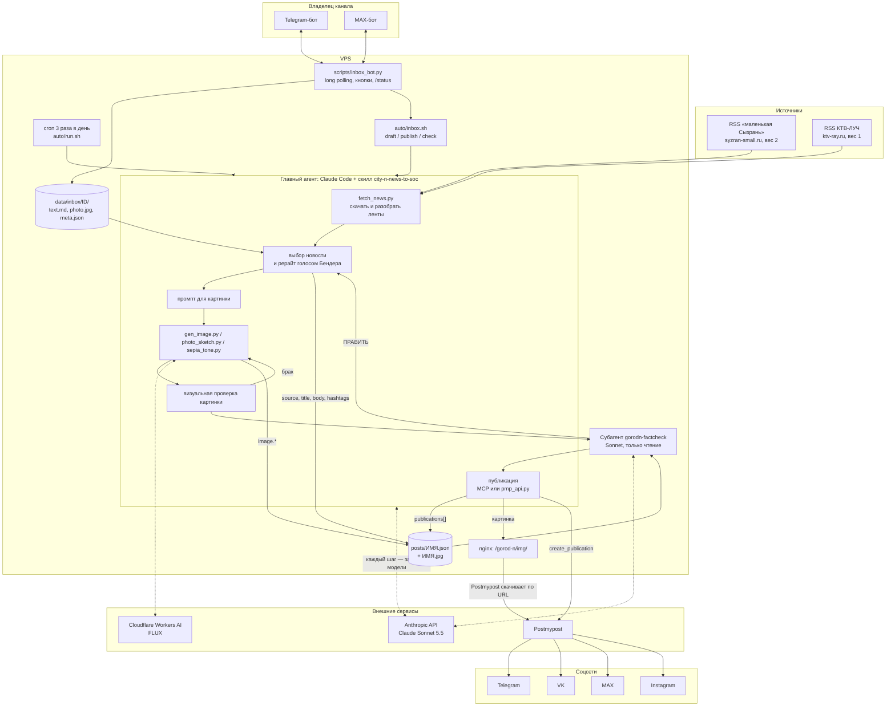
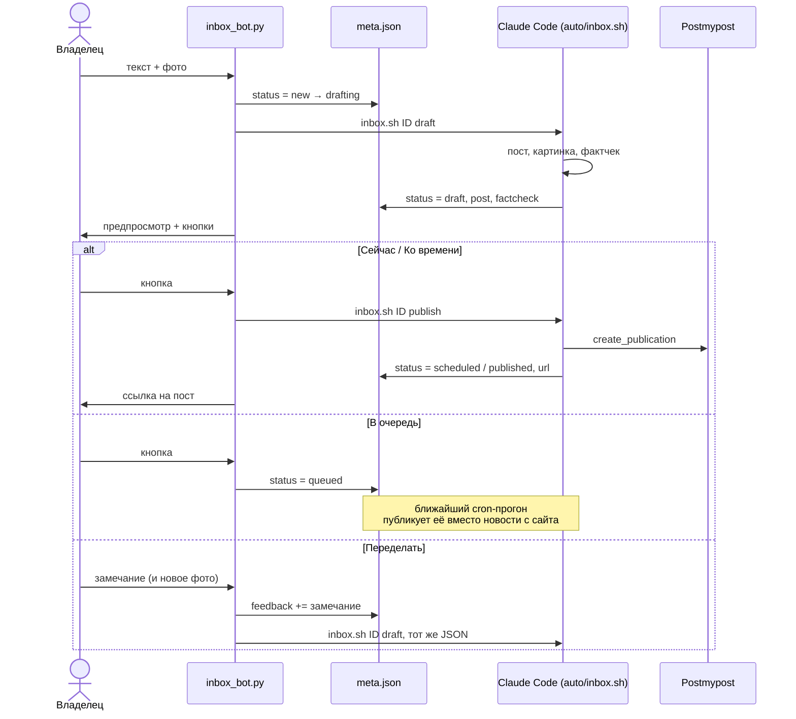

# Город Н

Автономный ИИ-конвейер: свежие новости Сызрани → пост голосом Остапа Бендера → иллюстрация → фактчек → публикация в Telegram, VK, MAX и Instagram. Три раза в день, без участия человека.

> «В городе Н сегодня произошло преинтереснейшее событие…»

<table>
  <tr>
    <th>VK</th>
    <th>Telegram</th>
    <th>Instagram</th>
    <th>Бот в MAX: /status</th>
  </tr>
  <tr>
    <td valign="top"></td>
    <td valign="top"></td>
    <td valign="top"></td>
    <td valign="top"></td>
  </tr>
</table>

## Стек

| Слой | Чем сделано |
|---|---|
| Оркестратор (главный агент) | [Claude Code](https://docs.anthropic.com/en/docs/claude-code) в headless-режиме (`claude -p`), модель **Claude Sonnet 5.5** |
| Логика конвейера | скилл Claude Code `.claude/skills/city-n-news-to-soc/SKILL.md`: шаги, правила, команды |
| Фактчекер | субагент Claude Code `gorodn-factcheck` (`.claude/agents/`), модель **Sonnet**, доступ только на чтение |
| Иллюстрации | Cloudflare Workers AI: **FLUX.1 schnell** (картинка к посту), **FLUX.2 klein 9B** (рисунок по фото), **FLUX.2 dev** (обложка) |
| Публикация | [Postmypost](https://postmypost.io): MCP-сервер, запасной путь — REST API v4.1 (`scripts/pmp_api.py`) |
| Бот для своих новостей | Python без фреймворков: Telegram Bot API и MAX Platform API, long polling |
| Хостинг | VPS (1 CPU, Linux): cron, nginx для раздачи картинок, Python venv |
| Связующее звено | JSON-файл поста `posts/*.json` (и `meta.json` для новостей из бота) |

## Архитектура



Главная идея: **детерминированная работа — в Python-скриптах, решения — у модели.** Скрипты скачивают ленты, собирают текст, генерируют и тонируют картинки, ходят в API Postmypost и записывают результат в JSON. Модель выбирает новость, пишет текст и промпт, смотрит на картинку, решает, что делать при ошибке. Порядок шагов и правила записаны текстом в скилле: Claude Code читает его при каждом запуске и вызывает скрипты через Bash.

## Конвейер по этапам

Вся логика этапов, описанных ниже, вынесена в отдельный скилл Claude Code — `.claude/skills/city-n-news-to-soc/SKILL.md`. Это Markdown-инструкция: порядок шагов, правила отбора и текста, точные команды скриптов, ID аккаунтов Postmypost, что делать при ошибке. Промпты запуска (`auto/prompt.md`, `auto/inbox_*.md`) короткие: они только говорят агенту, каким разделом скилла работать. Поэтому поведение конвейера меняется правкой скилла, без изменений в коде и cron, а локально в интерактивном Claude Code работает тот же сценарий.

Каждый автопрогон — один вызов `claude -p` на VPS. Модель на каждом шаге решает, что делать дальше, и вызывает инструменты (Bash, Read, Write, Agent, MCP). Один прогон — порядка 15 запросов к API.

### 0. Запуск по cron

`auto/run.sh` стартует в 7:30, 13:30 и 19:30 и выжидает случайную паузу 0–60 мин: посты выходят около 8, 14 и 20 часов, но не по секундам. Дальше:

- `flock` — второй прогон не стартует, пока идёт первый;
- ждёт, пока на сервере не работает другой Claude (один CPU);
- подгружает ключи из `~/.config/gorodn.env`;
- запускает `claude -p "$(cat auto/prompt.md)"` с белым списком инструментов (`--allowedTools`, запись только внутри проекта), `--permission-mode dontAsk` и жёстким `timeout 1500`;
- пишет в лог итог, число шагов, время и стоимость прогона из `--output-format json`.

Время старта после паузы записывается в `temp/auto/next_run`: его показывает команда `/status` в боте.

### 1. Хвосты прошлых прогонов

Агент ищет посты со статусом `scheduled` (`grep -l '"scheduled"' posts/*.json`), спрашивает Postmypost, вышли ли они, и переводит записи в `published` со ссылками. Затем проверяет очередь бота: `python scripts/inbox_bot.py queue`. Если там есть одобренная своя новость, публикуется она, а новость с сайта в этот прогон не берётся.

### 2. Сбор новостей — `scripts/fetch_news.py`

Обычный Python, без модели. Скачивает обе RSS-ленты (полный текст в `yandex:full-text`, у «маленькой Сызрани» кодировка windows-1251), отбрасывает статьи, приводит время к местному, сохраняет снимок ленты в `data/raw/` и печатает общий список:

```
МС  104xxx | 16.10 09:12 | <заголовок>
КТВ 195xxx | 16.10 08:40 | <заголовок>
```

`--show <ID>` — полный текст одной новости; если её уже нет в ленте, скрипт скачает страницу с сайта.

### 3. Выбор новости и рерайт — главный агент (Claude Sonnet 5.5)

Модель получает список и правила из скилла и `prompts/bender_style.md`:

- **берём** местное, позитивное, курьёзное; **не берём** криминал, ДТП, гибель, болезни, политику, военное, гороскопы;
- вес источников 2 : 1 в пользу «маленькой Сызрани»; одно событие на двух сайтах — источник МС;
- **дубли** — проверка по `news_id` (`grep`) и по смыслу: `source.title` всех постов за 3 дня;
- выбор и запасные кандидаты пишутся в `data/selected/<дата>.md`: следующий прогон возьмёт оттуда, если свежего ничего нет.

Затем модель пишет пост: заголовок до 10 слов, 4–5 предложений с зачином «В городе Н сегодня произошло преинтереснейшее событие:», 1–2 фразы Бендера из `prompts/bender_phrases.md` (без повторов за последние 5 постов), факты строго как в источнике, итоговая длина ≤ 1024 символов (лимит подписи к фото в Telegram). Результат — новый файл `posts/YYYYMMDD_HHMM-name.json`.

### 4. Промпт и картинка — главный агент → Cloudflare Workers AI

Модель пишет промпт на английском в фиксированном стиле (советская книжная иллюстрация 1930-х, тушь и акварель, сепия, Бендер в капитанской фуражке и белом шарфе) и кладёт его в `image.prompt`. **Без имён собственных**: FLUX рисует их буквами на картинке.

`python scripts/gen_image.py posts/<пост>.json` отправляет промпт в `@cf/black-forest-labs/flux-1-schnell` (8 шагов), сохраняет `.jpg` рядом с JSON и дописывает в `image` модель, шаги и seed.

Потом агент **смотрит на картинку сам** (Claude мультимодален): считает уши, руки и пальцы, ищет строки текста в небе. Брак — перегенерация, до двух раз.

### 5. Фактчек — субагент `gorodn-factcheck`

Отдельный агент с чистым контекстом: он не видел, как писался пост, и не может ничего менять (инструменты только Read, Bash, Grep, Glob). Получает путь к JSON, сам скачивает источник через `fetch_news.py --show` и сверяет:

- каждое утверждение — с текстом источника: имена, цифры, даты, кто что сделал;
- время («сегодня произошло» не должно противоречить датам), географию, запретные темы, тон шуток в адрес реальных людей;
- дубли, длину, форму, брак картинки.

Ответ — строгий формат: `ВЕРДИКТ: OK | ПРАВИТЬ | СТОП` и список правок с цитатами из поста и источника. `ПРАВИТЬ` — главный агент правит `title`/`body` и запускает фактчек ещё раз (не больше двух кругов). `СТОП` — берётся следующий кандидат, а если и он не прошёл, прогон заканчивается без публикации.

### 6. Публикация — Postmypost

1. Картинка копируется в каталог nginx на VPS; её URL пишется в `image.url`. Postmypost сам скачивает файл по ссылке (`init_upload` → `status_upload` → `file_id`).
2. `post_json.py` собирает текст: заголовок, пересказ, строку со ссылкой на источник, хэштеги. Для Instagram отдельный вариант, без ссылки (в подписи она не кликается), и при необходимости кадрирование под 4:5.
3. Одна `create_publication` на четыре аккаунта: TG, VK, MAX, Instagram, с отдельным `details` для каждого, `post_at` = сейчас + 2 мин.
4. Сразу записывается `publications[]` со `status: "scheduled"`, потом до трёх проверок `get_publication` раз в минуту. Вышло — `published` и ссылка на пост. Не успело — запись остаётся `scheduled` и её закроет шаг 1 следующего прогона.

Основной путь — MCP-сервер Postmypost (`.mcp.json`). Если MCP не отвечает, агент публикует через `scripts/pmp_api.py publish` — тот же процесс через REST API. Скрипт пропускает сети, где пост уже вышел или запланирован, так что повторный запуск не даёт дублей.

### 7. Итог

Агент печатает 3–5 строк (заголовок, источник, файл, ссылка VK или причина пропуска), `run.sh` пишет их в дневной лог вместе со стоимостью прогона.

## JSON поста — общая шина

У этапов нет общей памяти: каждый прогон Claude стартует с нуля, бот — отдельный процесс, фактчекер — отдельный агент. Всё, что один этап передаёт другому, лежит в файле `posts/<пост>.json`. Каждый этап дописывает в него свои поля:

| Этап | Кто пишет | Что появляется в JSON |
|---|---|---|
| Выбор и рерайт | главный агент | `id`, `created`, `source` (издание, URL, `news_id`, заголовок), `title`, `body`, `hashtags`, `publications: []` |
| Промпт | главный агент | `image.prompt` |
| Генерация | `gen_image.py` / `photo_sketch.py` / `sepia_tone.py` | `image.file`, `model`, `steps`, `seed` (или `source: "user_photo"`, `style`) |
| Фактчек | субагент читает, главный агент правит | исправленные `title` / `body` |
| Загрузка картинки | агент или `pmp_api.py` | `image.url` |
| Публикация | `post_json.py --record-postmypost` / `pmp_api.py` | запись в `publications[]` на каждую сеть: `status: "scheduled"`, `post_id`, `file_id` |
| Проверка выхода | следующий шаг или следующий прогон | та же запись → `status: "published"`, `url`, `published_at` |

Файл и есть состояние: пост считается вышедшим в сети, только если в `publications` есть запись с её `platform` и `status: "published"`. По этим записям агент решает, что догнать, бот показывает `/status`, а скрипты отсекают повторную публикацию.

```json
{
  "id": "20261006_1855-scorpions",
  "created": "2026-10-06T16:50:00+04:00",
  "source": {
    "name": "КТВ-ЛУЧ",
    "url": "https://ktv-ray.ru/n/195344/",
    "news_id": 195344,
    "title": "Заголовок новости в первоисточнике"
  },
  "title": "Ветер перемен подул в сторону «Авито» 🎸",
  "body": "В городе Н сегодня произошло преинтереснейшее событие: …",
  "hashtags": ["#городН", "#Сызрань", "#ОстапБендер", "#Scorpions"],
  "image": {
    "file": "20261006_1855-scorpions.jpg",
    "prompt": "Vintage Soviet book illustration …",
    "model": "@cf/black-forest-labs/flux-1-schnell",
    "steps": 8,
    "url": "https://…/gorod-n/img/20261006_1855-scorpions.jpg"
  },
  "publications": [
    {
      "platform": "vk",
      "channel": "В городе Н сегодня произошло",
      "status": "published",
      "published_at": "2026-10-11T21:45:00+04:00",
      "via": "postmypost",
      "project_id": 365896,
      "account_id": 2334893,
      "post_id": "32712035",
      "file_id": "53858370",
      "url": "https://vk.ru/wall-242062669_29",
      "error": null
    }
  ]
}
```

Имя файла — `YYYYMMDD_HHMM-name`: время публикации (местное, UTC+4) и короткое латинское слово о сюжете. Картинка лежит рядом с тем же именем. Записи `via: "postiz"` в старых постах — от прежнего сервиса публикации, отключён 12.10.2026.

## Бот для своих новостей

Владелец канала может прислать свою новость боту в Telegram или в MAX: текст, можно с фото или альбомом. Бот отвечает только ID из `TG_BOT_ALLOWED` / `MAX_BOT_ALLOWED`, сообщения остальных игнорирует.



- **Процессы.** `inbox_bot.py run` держит два потока long polling (Telegram `getUpdates`, MAX `/updates`). cron раз в 5 минут запускает `auto/inbox_bot.sh`: если бот жив, тот сразу выходит по `flock`, если упал — поднимает заново.
- **Связь с агентом.** Бот не зовёт модель сам. Он запускает в фоне `auto/inbox.sh <id> draft|publish`, то есть тот же Claude Code и тот же скилл, но с промптом `auto/inbox_draft.md` или `auto/inbox_publish.md`. Агент в конце обязательно пишет статус командой `inbox_bot.py set <id> status=…`, после чего `inbox.sh` вызывает `inbox_bot.py done <id>`, и бот присылает итог в тот мессенджер, откуда пришла новость.
- **Статусы `meta.json`:** `new → drafting → draft → publishing | queued → scheduled → published`, плюс `cancelled` и `error`. Если Claude упал, не записав статус, `done` переводит элемент в `error`.
- **Картинка.** Есть фото — оно идёт в пост в сепии (`sepia_tone.py`). Слово «карандаш» или «акварель» в тексте — рисунок по фото через FLUX.2 klein (`photo_sketch.py`, перед этим агент сам описывает композицию фото). Фото нет — генерация, как для обычного поста; пожелание можно дописать строкой «Картинка: …».
- **«От лица Бендера»** в тексте — пост от первого лица: Остап сам видел и рассказывает.
- `/status` — прошлый пост и где он вышел, что в работе и в очереди, когда следующий автопрогон.

## Надёжность

| Риск | Что сделано |
|---|---|
| Дубль поста | проверка по `news_id` и по смыслу за 3 дня (агент и фактчекер); `pmp_api.py` пропускает сети с `scheduled`/`published` |
| Выдуманные факты | отдельный фактчекер с чистым контекстом и без права записи, обязательный перед публикацией |
| Брак картинки | визуальная проверка агентом и фактчекером, до 2 перегенераций |
| MCP Postmypost недоступен | тот же сценарий через REST API (`pmp_api.py`) |
| Пост не вышел за время прогона | запись остаётся `scheduled`, её закрывает следующий прогон |
| Зависший агент | `timeout -s KILL` (25 мин для cron, 20 для бота), `flock` от параллельных запусков |
| Опасная команда агента | `--allowedTools`: запись только внутри каталога проекта; прямой публикации в VK API в проекте нет |
| Лимит Cloudflare | без картинки пост не публикуется, причина пишется в `data/selected/<дата>.md` |
| Секреты | только в переменных окружения (`~/.config/gorodn.env` на VPS), в репозитории — шаблон `.env.example` |

## Источники новостей

| Метка | Источник | Лента | Примечания |
|---|---|---|---|
| `МС` | маленькая Сызрань (приоритет) | `https://www.syzran-small.ru/rss-ya.php` | ~28 новостей с полным текстом, windows-1251; статьи `/pages-<id>` не берём; короткая ссылка `/news-<id>` |
| `КТВ` | КТВ-ЛУЧ | `https://ktv-ray.ru/feed.rss` | 20 новостей с полным текстом, UTF-8; в пост идёт короткая ссылка `https://ktv-ray.ru/n/<id>/` |

## Структура проекта

```
gorod-n/
├── auto/
│   ├── run.sh             — cron-прогон: пауза, блокировка, запуск claude -p, лог
│   ├── prompt.md          — промпт автопрогона
│   ├── inbox.sh           — прогон Claude по новости из бота (draft / publish / check)
│   ├── inbox_*.md         — промпты для этих режимов
│   └── inbox_bot.sh       — сторож бота (cron раз в 5 мин)
├── .claude/
│   ├── skills/city-n-news-to-soc/SKILL.md — сценарий конвейера для главного агента
│   ├── skills/vintage-pencil-sketch/      — рисунок по фото
│   └── agents/gorodn-factcheck.md         — субагент-фактчекер
├── .mcp.json              — MCP-сервер Postmypost (токен из ${PMP_TOKEN})
├── prompts/
│   ├── bender_style.md    — голос, правила текста, стиль иллюстраций
│   └── bender_phrases.md  — фразы Бендера (с пометками, какие нельзя про людей)
├── scripts/
│   ├── fetch_news.py      — RSS обоих источников: список, полный текст по ID
│   ├── post_json.py       — JSON поста: сборка текста, запись публикаций, переименование
│   ├── gen_image.py       — картинка по image.prompt (FLUX.1 schnell)
│   ├── photo_sketch.py    — фото → карандаш / акварель (FLUX.2 klein)
│   ├── sepia_tone.py, recolor_to_sky.py — тонирование
│   ├── gen_cover.py       — обложка группы VK (FLUX.2 dev)
│   ├── pmp_api.py         — публикация через REST API Postmypost
│   └── inbox_bot.py       — бот Telegram / MAX
├── data/
│   ├── raw/               — снимки лент по датам
│   ├── selected/          — выбранные новости и запасные кандидаты
│   └── inbox/             — новости из бота (на VPS)
├── posts/                 — посты: <имя>.json + <имя>.jpg
├── PLANS.md               — планы: как отвязаться от одного вендора модели
└── .env.example           — какие ключи нужны
```

## Запуск

Ключи (`CLOUDFLARE_ACCOUNT_ID`, `CLOUDFLARE_API_TOKEN`, `PMP_TOKEN`, на VPS ещё `CLAUDE_CODE_OAUTH_TOKEN` и токены ботов) — в переменных окружения, список в `.env.example`.

```bash
auto/run.sh --now                                  # автопрогон без случайной паузы
python scripts/fetch_news.py                       # свежие новости
python scripts/post_json.py posts/<пост>.json      # собранный текст и статусы
python scripts/pmp_api.py publish posts/<пост>.json
```

Локально тот же конвейер запускается в интерактивном Claude Code фразой «сделай пост»: скилл тот же, но перед публикацией агент показывает пост и ждёт согласия.
